# Freischaltplan der Aufträge

> Automatisch erzeugt mit `node tools/questplan.mjs` aus `data/tickets.json` – **nicht von Hand bearbeiten**.
> Pfeil X → Y: Y wird frei, sobald X erledigt ist. Hat Y mehrere eingehende Pfeile, müssen **alle** erledigt sein.
> Buchstabe = Aufgabentyp (siehe Legende). PNG: `docs/questplan.png`.

Startaufträge (sofort frei): Der rote Blitz.
Anzahl Aufträge: 53, verdienbar: 4950 €.

```mermaid
flowchart LR
  t01_sportwagen["<b>A</b> Der rote Blitz<br/><small>Frau Brösel · Lindenstraße · 50 €</small>"]:::tA
  t02_kevin["<b>A</b> Bremsen durch?<br/><small>Kevin · Radl-Eck · 60 €</small>"]:::tA
  t03_bus["<b>A</b> Ruckelt der Bus?<br/><small>Busfahrer Ötzi · Busbahnhof · 70 €</small>"]:::tA
  t04_brezel["<b>A</b> Der Hund, der zurückläuft<br/><small>Bäckermeister Huber · Bäckerei · 60 €</small>"]:::tA
  t05_radeln["<b>H</b> Partnerschafts-Radeln<br/><small>Bürgermeisterin Kranz · Stadtpark · 80 €</small>"]:::tH
  t06_broesel_ampel["<b>H</b> Frau Brösels Rache<br/><small>Frau Brösel · Lindenstraße · 90 €</small>"]:::tH
  t07_skater["<b>G</b> Zu schnell im Skatepark?<br/><small>Jo · Skatepark · 70 €</small>"]:::tG
  t08_einkaufswagen["<b>G</b> Der Einkaufswagen<br/><small>Filialleiterin Yıldız · Supermarkt · 90 €</small>"]:::tG
  t09_tacho["<b>C</b> Der verschmierte Ausdruck<br/><small>Kevin · Radl-Eck · 80 €</small>"]:::tC
  t10_ampelkamera["<b>C</b> Die nasse Ampelkamera<br/><small>Busfahrer Ötzi · Busbahnhof · 80 €</small>"]:::tC
  t11_stadtlauf["<b>C</b> Der Stadtlauf<br/><small>Bürgermeisterin Kranz · Rathaus · 90 €</small>"]:::tC
  t12_ralf_brezel["<b>E</b> Ralfs erstes Diagramm<br/><small>Ralf · Rathaus · 70 €</small>"]:::tE
  t13_ralf_kevin["<b>E</b> Ralf und die Bremse<br/><small>Ralf · Rathaus · 80 €</small>"]:::tE
  t14_ralf_bus["<b>E</b> Ralfs Busfahrt<br/><small>Ralf · Rathaus · 90 €</small>"]:::tE
  t15_live_brezel["<b>F</b> Brezels Ersatzrunde<br/><small>Bäckermeister Huber · Bäckerei · 70 €</small>"]:::tF
  t16_live_gerda["<b>F</b> Oma Gerda am Zebrastreifen<br/><small>Oma Gerda · Lindenstraße · 80 €</small>"]:::tF
  t17_live_kevin["<b>F</b> Kevins Express-Lieferung<br/><small>Kevin · Radl-Eck · 90 €</small>"]:::tF
  t18_konstrukt_kevin["<b>I</b> Hausaufgabe: Selbst zeichnen!<br/><small>Frau Dr. Ohm · Schule · 80 €</small>"]:::tI
  t19_konstrukt_bus["<b>I</b> Hausaufgabe: Der Bus<br/><small>Frau Dr. Ohm · Schule · 90 €</small>"]:::tI
  t20_konstrukt_wagen["<b>I</b> Hausaufgabe: Die Falle<br/><small>Frau Dr. Ohm · Schule · 100 €</small>"]:::tI
  t21_reaktion_rad["<b>J</b> Die Schrecksekunde<br/><small>Frau Dr. Ohm · Schule · 70 €</small>"]:::tJ
  t22_reaktion_auto["<b>J</b> Tempo 30 vor der Schule?<br/><small>Bürgermeisterin Kranz · Rathaus · 90 €</small>"]:::tJ
  t23_freihand_brezel["<b>B</b> Brezels Tagebuch<br/><small>Bäckermeister Huber · Bäckerei · 80 €</small>"]:::tB
  t24_flaeche_jo["<b>K</b> Wie lang ist mein Run?<br/><small>Jo · Skatepark · 80 €</small>"]:::tK
  t25_flaeche_kevin["<b>K</b> Hin und zurück<br/><small>Kevin · Radl-Eck · 90 €</small>"]:::tK
  t26_flaeche_wagen["<b>K</b> Wie knapp war's?<br/><small>Filialleiterin Yıldız · Supermarkt · 100 €</small>"]:::tK
  t27_steigung_blitz["<b>L</b> Der rote Blitz am Abend<br/><small>Frau Brösel · Lindenstraße · 70 €</small>"]:::tL
  t28_steigung_ralf["<b>L</b> Ralfs positive Rückwärtsrechnung<br/><small>Ralf · Rathaus · 80 €</small>"]:::tL
  t29_steigung_bus["<b>L</b> Bremst Ötzi zu scharf?<br/><small>Busfahrer Ötzi · Busbahnhof · 90 €</small>"]:::tL
  t30_regie_imagefilm["<b>D</b> Der Imagefilm<br/><small>Bürgermeisterin Kranz · Rathaus · 90 €</small>"]:::tD
  t31_strobo_erstes["<b>O</b> Das erste Blitzfoto<br/><small>Slavi · Fotolabor · 60 €</small>"]:::tO
  t32_strobo_kevin["<b>M</b> Kevin im Blitzlicht<br/><small>Slavi · Fotolabor · 70 €</small>"]:::tM
  t33_strobo_fallschirm["<b>N</b> Der schwebende Springer<br/><small>Slavi · Fotolabor · 70 €</small>"]:::tN
  t34_strobo_rinne["<b>O</b> Die Kugel in der Rinne<br/><small>Slavi · Fotolabor · 80 €</small>"]:::tO
  t35_strobo_auto["<b>M</b> Blitz in der 30er-Zone<br/><small>Slavi · Fotolabor · 90 €</small>"]:::tM
  t36_strobo_jo["<b>N</b> Jo im Doppelbild<br/><small>Slavi · Fotolabor · 80 €</small>"]:::tN
  t37_strobo_bremsen["<b>O</b> Kevin bremst<br/><small>Slavi · Fotolabor · 90 €</small>"]:::tO
  t38_strobo_pendel["<b>O</b> Das Pendel<br/><small>Slavi · Fotolabor · 100 €</small>"]:::tO
  t39_schwer_zuordnen["<b>A</b> Kevins Wende<br/><small>Busfahrer Ötzi · Busbahnhof · 120 €</small>"]:::tA
  t40_schwer_rechnen["<b>H</b> Die Paket-Jagd<br/><small>Paul Paket · Lindenstraße · 130 €</small>"]:::tH
  t41_schwer_beschreiben["<b>G</b> Jo in der Halfpipe<br/><small>Jo · Skatepark · 120 €</small>"]:::tG
  t42_schwer_achsen["<b>C</b> Der Wende-Tacho<br/><small>Kevin · Radl-Eck · 120 €</small>"]:::tC
  t43_schwer_fehlerjagd["<b>E</b> Ralfs krumme Kurve<br/><small>Ralf · Rathaus · 120 €</small>"]:::tE
  t44_schwer_live["<b>F</b> Pauls Zustellrunde<br/><small>Paul Paket · Bäckerei · 130 €</small>"]:::tF
  t45_schwer_konstrukteur["<b>I</b> Hausaufgabe: Die Wende<br/><small>Frau Dr. Ohm · Schule · 130 €</small>"]:::tI
  t46_schwer_reaktion["<b>J</b> Landstraße bei Regen<br/><small>Frau Dr. Ohm · Schule · 120 €</small>"]:::tJ
  t47_schwer_freihand["<b>B</b> Kevin ohne Video<br/><small>Kevin · Radl-Eck · 130 €</small>"]:::tB
  t48_schwer_flaeche["<b>K</b> Hin, um und zurück<br/><small>Filialleiterin Yıldız · Supermarkt · 130 €</small>"]:::tK
  t49_schwer_steigung["<b>L</b> Bremsen durch null<br/><small>Busfahrer Ötzi · Busbahnhof · 120 €</small>"]:::tL
  t50_schwer_regie["<b>D</b> Die Verfolgungsjagd<br/><small>Bürgermeisterin Kranz · Rathaus · 140 €</small>"]:::tD
  t51_schwer_strobo_beschreiben["<b>N</b> Der Wurf nach oben<br/><small>Slavi · Fotolabor · 120 €</small>"]:::tN
  t52_schwer_strobo_rechnen["<b>M</b> Die schräge Rinne<br/><small>Slavi · Fotolabor · 130 €</small>"]:::tM
  t53_schwer_strobo_bauen["<b>O</b> Gas und Bremse<br/><small>Slavi · Fotolabor · 140 €</small>"]:::tO
  t01_sportwagen --> t02_kevin
  t02_kevin --> t03_bus
  t01_sportwagen --> t04_brezel
  t01_sportwagen --> t05_radeln
  t03_bus --> t06_broesel_ampel
  t05_radeln --> t06_broesel_ampel
  t04_brezel --> t07_skater
  t07_skater --> t08_einkaufswagen
  t02_kevin --> t09_tacho
  t03_bus --> t10_ampelkamera
  t05_radeln --> t11_stadtlauf
  t04_brezel --> t12_ralf_brezel
  t12_ralf_brezel --> t13_ralf_kevin
  t02_kevin --> t13_ralf_kevin
  t13_ralf_kevin --> t14_ralf_bus
  t03_bus --> t14_ralf_bus
  t04_brezel --> t15_live_brezel
  t15_live_brezel --> t16_live_gerda
  t16_live_gerda --> t17_live_kevin
  t02_kevin --> t18_konstrukt_kevin
  t18_konstrukt_kevin --> t19_konstrukt_bus
  t03_bus --> t19_konstrukt_bus
  t19_konstrukt_bus --> t20_konstrukt_wagen
  t08_einkaufswagen --> t20_konstrukt_wagen
  t02_kevin --> t21_reaktion_rad
  t21_reaktion_rad --> t22_reaktion_auto
  t15_live_brezel --> t23_freihand_brezel
  t07_skater --> t24_flaeche_jo
  t09_tacho --> t25_flaeche_kevin
  t08_einkaufswagen --> t26_flaeche_wagen
  t01_sportwagen --> t27_steigung_blitz
  t12_ralf_brezel --> t28_steigung_ralf
  t10_ampelkamera --> t29_steigung_bus
  t05_radeln --> t30_regie_imagefilm
  t01_sportwagen --> t31_strobo_erstes
  t31_strobo_erstes --> t32_strobo_kevin
  t32_strobo_kevin --> t33_strobo_fallschirm
  t33_strobo_fallschirm --> t34_strobo_rinne
  t34_strobo_rinne --> t35_strobo_auto
  t35_strobo_auto --> t36_strobo_jo
  t36_strobo_jo --> t37_strobo_bremsen
  t37_strobo_bremsen --> t38_strobo_pendel
  t04_brezel --> t39_schwer_zuordnen
  t06_broesel_ampel --> t40_schwer_rechnen
  t08_einkaufswagen --> t41_schwer_beschreiben
  t11_stadtlauf --> t42_schwer_achsen
  t14_ralf_bus --> t43_schwer_fehlerjagd
  t17_live_kevin --> t44_schwer_live
  t20_konstrukt_wagen --> t45_schwer_konstrukteur
  t22_reaktion_auto --> t46_schwer_reaktion
  t45_schwer_konstrukteur --> t46_schwer_reaktion
  t23_freihand_brezel --> t47_schwer_freihand
  t26_flaeche_wagen --> t48_schwer_flaeche
  t29_steigung_bus --> t49_schwer_steigung
  t30_regie_imagefilm --> t50_schwer_regie
  t38_strobo_pendel --> t51_schwer_strobo_beschreiben
  t51_schwer_strobo_beschreiben --> t52_schwer_strobo_rechnen
  t52_schwer_strobo_rechnen --> t53_schwer_strobo_bauen
  classDef tA fill:#ffcd75,stroke:#1a1c2c,color:#1a1c2c
  classDef tB fill:#f6a6b2,stroke:#1a1c2c,color:#1a1c2c
  classDef tC fill:#a7f070,stroke:#1a1c2c,color:#1a1c2c
  classDef tD fill:#c7a6ff,stroke:#1a1c2c,color:#1a1c2c
  classDef tE fill:#ff9f7a,stroke:#1a1c2c,color:#1a1c2c
  classDef tF fill:#73eff7,stroke:#1a1c2c,color:#1a1c2c
  classDef tG fill:#ffe8a3,stroke:#1a1c2c,color:#1a1c2c
  classDef tH fill:#9fc5ff,stroke:#1a1c2c,color:#1a1c2c
  classDef tI fill:#b6e3b0,stroke:#1a1c2c,color:#1a1c2c
  classDef tJ fill:#f0b0e0,stroke:#1a1c2c,color:#1a1c2c
  classDef tK fill:#d9d9a0,stroke:#1a1c2c,color:#1a1c2c
  classDef tL fill:#a0d9d0,stroke:#1a1c2c,color:#1a1c2c
  classDef tM fill:#e0c8a8,stroke:#1a1c2c,color:#1a1c2c
  classDef tN fill:#c8d8f0,stroke:#1a1c2c,color:#1a1c2c
  classDef tO fill:#f0d0a0,stroke:#1a1c2c,color:#1a1c2c
```

## Legende
| Buchstabe | Typ | Aufträge |
|---|---|---|
| A | Zuordnen | 5 |
| B | Freihand zeichnen | 2 |
| C | Achsen-Detektiv | 4 |
| D | Regie | 2 |
| E | Fehlerjagd | 4 |
| F | Live-Steuerung | 4 |
| G | Beschreiben | 3 |
| H | Berechnen | 3 |
| I | Konstrukteur | 4 |
| J | Reaktionstest | 3 |
| K | Flächen-Puzzle | 4 |
| L | Steigungsdreieck | 4 |
| M | Stroboskop: rechnen | 3 |
| N | Stroboskop: beschreiben | 3 |
| O | Stroboskop: bauen | 5 |

## Liste
| Auftrag | Typ | von | Ort | Lohn | braucht |
|---|---|---|---|---|---|
| Der rote Blitz | A | Frau Brösel | Lindenstraße | 50 € | – |
| Bremsen durch? | A | Kevin | Radl-Eck | 60 € | Der rote Blitz |
| Ruckelt der Bus? | A | Busfahrer Ötzi | Busbahnhof | 70 € | Bremsen durch? |
| Der Hund, der zurückläuft | A | Bäckermeister Huber | Bäckerei | 60 € | Der rote Blitz |
| Partnerschafts-Radeln | H | Bürgermeisterin Kranz | Stadtpark | 80 € | Der rote Blitz |
| Frau Brösels Rache | H | Frau Brösel | Lindenstraße | 90 € | Ruckelt der Bus?, Partnerschafts-Radeln |
| Zu schnell im Skatepark? | G | Jo | Skatepark | 70 € | Der Hund, der zurückläuft |
| Der Einkaufswagen | G | Filialleiterin Yıldız | Supermarkt | 90 € | Zu schnell im Skatepark? |
| Der verschmierte Ausdruck | C | Kevin | Radl-Eck | 80 € | Bremsen durch? |
| Die nasse Ampelkamera | C | Busfahrer Ötzi | Busbahnhof | 80 € | Ruckelt der Bus? |
| Der Stadtlauf | C | Bürgermeisterin Kranz | Rathaus | 90 € | Partnerschafts-Radeln |
| Ralfs erstes Diagramm | E | Ralf | Rathaus | 70 € | Der Hund, der zurückläuft |
| Ralf und die Bremse | E | Ralf | Rathaus | 80 € | Ralfs erstes Diagramm, Bremsen durch? |
| Ralfs Busfahrt | E | Ralf | Rathaus | 90 € | Ralf und die Bremse, Ruckelt der Bus? |
| Brezels Ersatzrunde | F | Bäckermeister Huber | Bäckerei | 70 € | Der Hund, der zurückläuft |
| Oma Gerda am Zebrastreifen | F | Oma Gerda | Lindenstraße | 80 € | Brezels Ersatzrunde |
| Kevins Express-Lieferung | F | Kevin | Radl-Eck | 90 € | Oma Gerda am Zebrastreifen |
| Hausaufgabe: Selbst zeichnen! | I | Frau Dr. Ohm | Schule | 80 € | Bremsen durch? |
| Hausaufgabe: Der Bus | I | Frau Dr. Ohm | Schule | 90 € | Hausaufgabe: Selbst zeichnen!, Ruckelt der Bus? |
| Hausaufgabe: Die Falle | I | Frau Dr. Ohm | Schule | 100 € | Hausaufgabe: Der Bus, Der Einkaufswagen |
| Die Schrecksekunde | J | Frau Dr. Ohm | Schule | 70 € | Bremsen durch? |
| Tempo 30 vor der Schule? | J | Bürgermeisterin Kranz | Rathaus | 90 € | Die Schrecksekunde |
| Brezels Tagebuch | B | Bäckermeister Huber | Bäckerei | 80 € | Brezels Ersatzrunde |
| Wie lang ist mein Run? | K | Jo | Skatepark | 80 € | Zu schnell im Skatepark? |
| Hin und zurück | K | Kevin | Radl-Eck | 90 € | Der verschmierte Ausdruck |
| Wie knapp war's? | K | Filialleiterin Yıldız | Supermarkt | 100 € | Der Einkaufswagen |
| Der rote Blitz am Abend | L | Frau Brösel | Lindenstraße | 70 € | Der rote Blitz |
| Ralfs positive Rückwärtsrechnung | L | Ralf | Rathaus | 80 € | Ralfs erstes Diagramm |
| Bremst Ötzi zu scharf? | L | Busfahrer Ötzi | Busbahnhof | 90 € | Die nasse Ampelkamera |
| Der Imagefilm | D | Bürgermeisterin Kranz | Rathaus | 90 € | Partnerschafts-Radeln |
| Das erste Blitzfoto | O | Slavi | Fotolabor | 60 € | Der rote Blitz |
| Kevin im Blitzlicht | M | Slavi | Fotolabor | 70 € | Das erste Blitzfoto |
| Der schwebende Springer | N | Slavi | Fotolabor | 70 € | Kevin im Blitzlicht |
| Die Kugel in der Rinne | O | Slavi | Fotolabor | 80 € | Der schwebende Springer |
| Blitz in der 30er-Zone | M | Slavi | Fotolabor | 90 € | Die Kugel in der Rinne |
| Jo im Doppelbild | N | Slavi | Fotolabor | 80 € | Blitz in der 30er-Zone |
| Kevin bremst | O | Slavi | Fotolabor | 90 € | Jo im Doppelbild |
| Das Pendel | O | Slavi | Fotolabor | 100 € | Kevin bremst |
| Kevins Wende | A | Busfahrer Ötzi | Busbahnhof | 120 € | Der Hund, der zurückläuft |
| Die Paket-Jagd | H | Paul Paket | Lindenstraße | 130 € | Frau Brösels Rache |
| Jo in der Halfpipe | G | Jo | Skatepark | 120 € | Der Einkaufswagen |
| Der Wende-Tacho | C | Kevin | Radl-Eck | 120 € | Der Stadtlauf |
| Ralfs krumme Kurve | E | Ralf | Rathaus | 120 € | Ralfs Busfahrt |
| Pauls Zustellrunde | F | Paul Paket | Bäckerei | 130 € | Kevins Express-Lieferung |
| Hausaufgabe: Die Wende | I | Frau Dr. Ohm | Schule | 130 € | Hausaufgabe: Die Falle |
| Landstraße bei Regen | J | Frau Dr. Ohm | Schule | 120 € | Tempo 30 vor der Schule?, Hausaufgabe: Die Wende |
| Kevin ohne Video | B | Kevin | Radl-Eck | 130 € | Brezels Tagebuch |
| Hin, um und zurück | K | Filialleiterin Yıldız | Supermarkt | 130 € | Wie knapp war's? |
| Bremsen durch null | L | Busfahrer Ötzi | Busbahnhof | 120 € | Bremst Ötzi zu scharf? |
| Die Verfolgungsjagd | D | Bürgermeisterin Kranz | Rathaus | 140 € | Der Imagefilm |
| Der Wurf nach oben | N | Slavi | Fotolabor | 120 € | Das Pendel |
| Die schräge Rinne | M | Slavi | Fotolabor | 130 € | Der Wurf nach oben |
| Gas und Bremse | O | Slavi | Fotolabor | 140 € | Die schräge Rinne |
